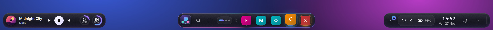
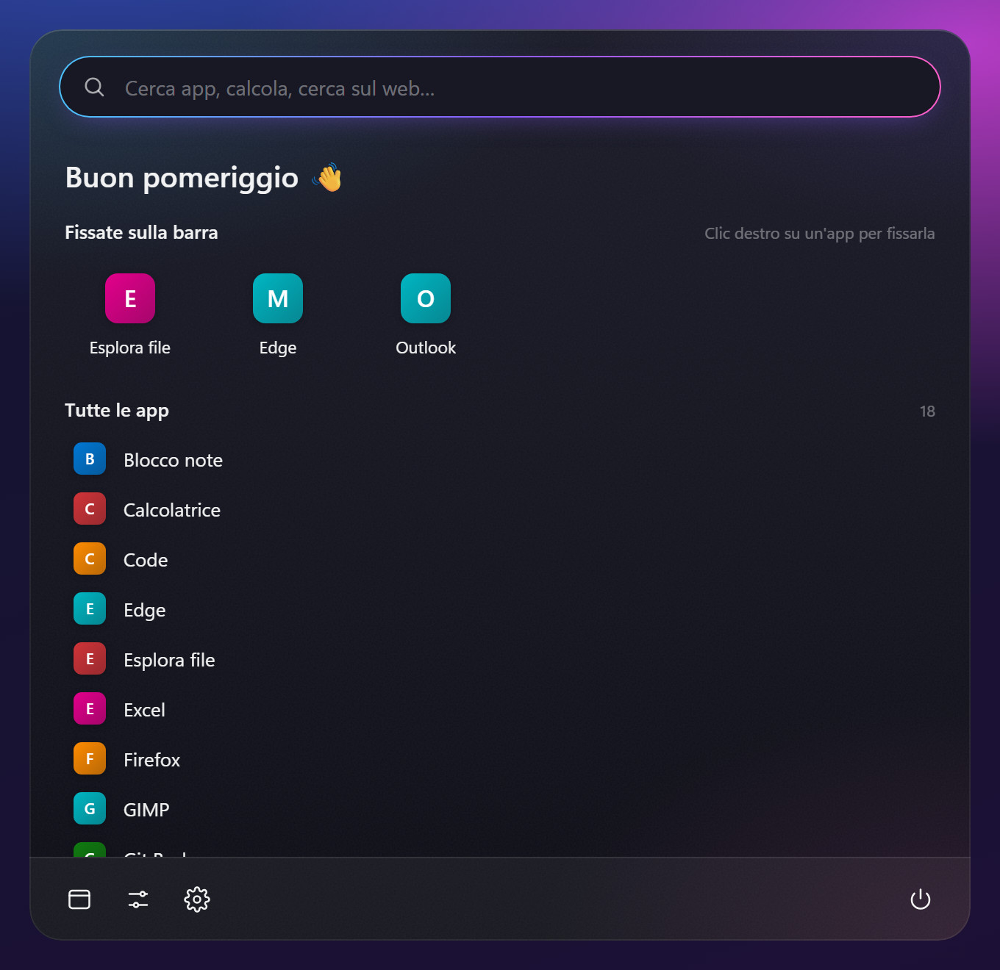
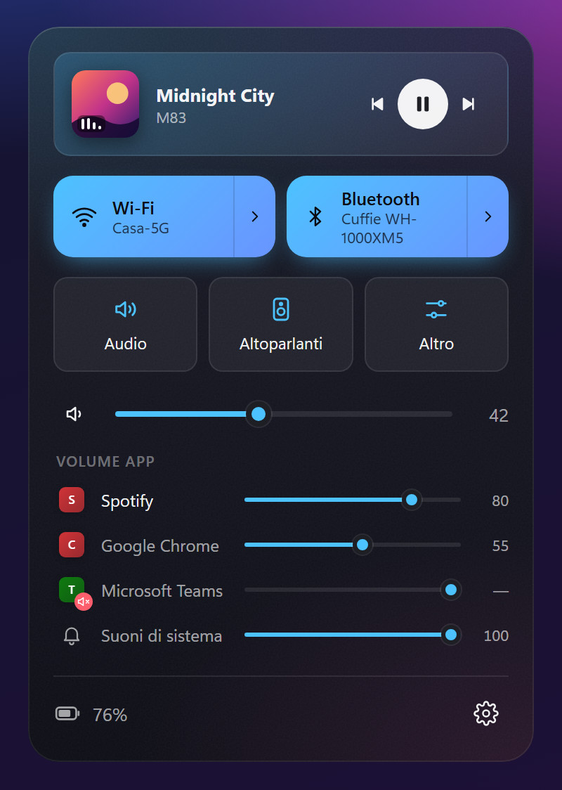

# Iacobar

**A modern, lightweight taskbar for Windows 11.**



<p align="center">
  
  
</p>

<sub>Screenshots with sample data: the letters stand in for the real app icons.</sub>

Iacobar replaces the Windows taskbar **without removing it**: on start it hides
the native taskbar, and when you quit it gives it back exactly as it was.

Built with [Tauri 2](https://tauri.app) (Rust + Win32) and [Svelte 5](https://svelte.dev).
The installer is about 2.5 MB and the bar idles at well under 1% CPU.
The user interface is currently in Italian.

> Iacobar is an independent project. It is not affiliated with, endorsed by or
> sponsored by Microsoft. "Windows" is a trademark of Microsoft Corporation.

## Features

**Taskbar**
- Two layouts: a **fixed** bar that reserves its space like the native one, or
  **floating** islands over your windows (clicks between the islands reach the
  apps below), which can be tucked away and brought back from a small pill.
- One bar per monitor, each showing the windows of its own screen (optional).
- Pinned apps you can reorder by dragging or from the right-click menu.
- The focused app is drawn slightly bigger and raised; apps bounce while launching.
- Apps that ask for attention (a new message, a finished download) glow orange.
- Crowded dock: icons shrink first, then the dock scrolls; nothing ever overlaps.

**Windows and apps**
- Live window previews on hover (DWM thumbnails).
- Right-click menu with the app's windows, **recent files and folders** and
  tasks (its jump list), pin/unpin, move left/right, close.
- Drag a file onto an icon: hold it there to bring the app forward, drop it to
  open the file with that app.
- Middle click opens a new instance, the mouse wheel cycles through windows.

**Start and search**
- Fast fuzzy launcher for desktop and Store apps, quick maths
  (`12*(3+4)`, Enter copies the result) and web search.
- Power buttons with confirmation. Alt+F4 on the bar opens the
  "Shut down Windows" dialog, just like the native taskbar.

**System**
- Network, volume and battery, with a quick panel: Wi-Fi and Bluetooth toggles
  (and the name of the connected Bluetooth device), **Wi-Fi network list**,
  **audio output switcher**, **per-app volume mixer**, master volume.
- Now-playing widget with **album art** and media controls.
- CPU and RAM gauges, calendar with week numbers, optional seconds.
- Notification-area icons (background apps) in a compact panel.
- Virtual desktops indicator.

**Looks**
- Seven themes plus a **"From wallpaper"** theme that takes its colours from
  your desktop background, and an optional automatic light theme by day
  (following Windows' light/dark mode or the time of day).
- Accent colour from Windows, from the theme or picked freely.
- Icon size, island corners and a reduced-motion mode.

**Safety and updates**
- Automatic backups of your settings, export and import to a file.
- Automatic updates: a dot on Start tells you when a new version is out, and
  one click in the bar settings installs it and restarts the bar.

## Install

Download the latest `Iacobar_x.y.z_x64-setup.exe` from the
[Releases](https://github.com/IacoM/iacobar/releases) page and run it.
It installs for the current user only (no administrator rights) and starts with
Windows by default (you can turn this off in the settings).

> **Windows may warn that the app is not recognised.** The installer is not
> code-signed yet, so SmartScreen shows "Windows protected your PC": choose
> *More info → Run anyway*. On PCs with Smart App Control turned on, unsigned
> apps cannot run at all.

From version 0.2.0 on, Iacobar updates itself: when a new release is out a dot
appears on the Start button, and *Start → bar settings → Updates → Update now*
downloads it, installs it and restarts the bar. Version 0.1.0 has no updater:
if you have it, install 0.2.0 by hand once.

Uninstalling from *Settings → Apps* gives the Windows taskbar back and removes
the autostart entry.

### Getting the Windows taskbar back

- Normal quit (Start → bar settings → *Quit and restore the Windows taskbar*),
  `Ctrl+C` during development or a crash: the native taskbar is restored.
- If the process was killed (e.g. from Task Manager), run
  `iacobar.exe --restore` or `powershell -File restore-taskbar.ps1`.

## Privacy

Iacobar works on your PC and sends no data about you anywhere. The only network
access is the update check: a few seconds after start and then every 6 hours it
downloads `latest.json` from this repository's GitHub releases (and, when you
choose to update, the installer). To work it reads, locally: your open windows, installed apps, the current media session,
the wallpaper (only for the "From wallpaper" theme), saved Wi-Fi networks and
audio devices. Settings are stored in `%APPDATA%\app.iacobar`.

## Build from source

Requirements: Windows 10/11, [Node.js](https://nodejs.org) LTS,
[Rust](https://rustup.rs) and the Visual Studio Build Tools (C++ workload).

```bash
npm install            # frontend dependencies
npm run tauri dev      # run the bar with hot reload
npm run tauri build    # build the installer (src-tauri/target/release/bundle/nsis)
npm run dev            # UI only, in the browser, with mock data
```

In the browser you can open the panels directly, e.g.
`http://127.0.0.1:1420/flyout?panel=start` (or `calendar`, `audio`, `group`,
`settings`, `tray`). Useful URL flags: `?floating`, `?apps=20`, `?theme=oceano`, `?update`.

To keep the Windows taskbar visible while developing:

```powershell
$env:IACOBAR_KEEP_WINDOWS_TASKBAR = "1"; npm run tauri dev
```

### Publishing a release

Every release goes to two places with one command: **GitHub** (the installer,
updated by the app itself) and the **Microsoft Store** (an MSIX package,
updated by the Store). The same `iacobar.exe` is in both: when it runs from the
Store package it leaves updates to the Store and uses the package's startup
task for *Start with Windows*.

For each release:

1. Bump the version in `package.json`, `src-tauri/tauri.conf.json` and
   `src-tauri/Cargo.toml` (the three must match), commit and push.
2. Build and publish:

   ```powershell
   powershell -File scripts\release.ps1 -Notes "What's new, shown in the app" -Publish
   ```

   It builds the installer, `latest.json` and the MSIX into `release\` (ignored
   by git), creates the GitHub release `v<version>` with the installer and
   `latest.json`, and sends the MSIX to the Store. Without `-Publish` it only
   builds.
3. GitHub: within 6 hours every running copy shows the update dot (*Check for
   updates* in the bar settings checks right away). Store: the new version
   goes through certification (usually 1–3 days), then the Store updates it.

#### One-time setup

**Update signing key.** Made with
`npx tauri signer generate -w "$HOME\.tauri\iacobar.key"`. The public key is in
`src-tauri/tauri.conf.json` (`plugins.updater.pubkey`); the private key **stays
out of the repository**. Keep a copy somewhere safe (a password manager): if it
is lost, installed copies can no longer be updated and users have to reinstall
by hand.

**GitHub CLI**, used to create the releases:

```powershell
winget install GitHub.cli
gh auth login
```

**Microsoft Store.**

1. Open a developer account (free for individuals) from
   [storedeveloper.microsoft.com](https://storedeveloper.microsoft.com).
2. In [Partner Center](https://partner.microsoft.com/dashboard) →
   *Apps and games* → *New product* → *MSIX or PWA app*, reserve the name
   **Iacobar**.
3. *Product management → Product identity*: copy `Package/Identity/Name`,
   `Package/Identity/Publisher`, `Package/Properties/PublisherDisplayName` and
   the *Store ID* into `msix/store.json` (`identityName`, `publisher`,
   `publisherDisplayName`, `productId`) and commit it. These are public
   identifiers, not secrets.
4. Build the MSIX (`scripts\release.ps1` without `-Publish`) and make the
   **first submission by hand** in Partner Center: free pricing, category
   *Utilities & tools*, age rating questionnaire, Store listing (description,
   screenshots from `docs/screenshots`, privacy policy: link to the
   [Privacy](#privacy) section), upload `release\Iacobar_<version>_x64.msix`.
   In *Notes for certification* explain that `runFullTrust` is needed because
   Iacobar is a desktop app that replaces the Windows taskbar (it hides
   Explorer's taskbar and gives it back when it quits).
5. Let the script submit later versions: in Partner Center → *Account settings
   → User management → Microsoft Entra applications*, create an application
   with the *Manager* role and a key (client secret). Then install the
   [Microsoft Store Developer CLI](https://learn.microsoft.com/windows/apps/publish/msstore-dev-cli/overview)
   and connect it once (tenant, seller and client IDs are in Partner Center):

   ```powershell
   winget install "Microsoft Store Developer CLI"
   msstore reconfigure --tenantId <tenant> --sellerId <seller> --clientId <client> --clientSecret <secret>
   ```

   The secret stays in the CLI's settings on this PC, never in the repository.

### Project layout

```
src-tauri/src/
  lib.rs           commands, panels (flyouts), previews, watchdog
  taskbar.rs       hides / restores the native taskbar
  bars.rs          one bar per monitor, reserved screen space, click regions
  wins.rs          open windows (WinEvent hooks), attention (shell hook)
  tray.rs          notification-area icons
  apps.rs          installed apps, launching
  jumplist.rs      recent items of an app
  icons.rs         icon extraction
  system.rs        volume, network, battery, CPU/RAM, accent colour
  mixer.rs         per-app volume
  audio_out.rs     audio output devices
  wifi.rs          Wi-Fi networks
  radios.rs        Wi-Fi / Bluetooth on/off
  media.rs         now playing, album art
  wallpaper.rs     wallpaper colours
  vdesk.rs         virtual desktops
  backup.rs        settings backups, export / import
  updater.rs       update checks and install (GitHub releases)
  package.rs       Microsoft Store (MSIX) build: detection, startup task
  session.rs       sign-out, shutdown, Store uninstall: taskbar back first
  config.rs        settings and pinned apps
src/
  routes/+page.svelte            the bar
  routes/flyout/+page.svelte     window shared by all panels
  routes/preview/+page.svelte    live previews
  lib/components/*Panel.svelte   Start, calendar, audio, app menu, settings, tray
  lib/theme.ts                   themes
  lib/mock.ts                    fake data to work on the UI in a browser
msix/AppxManifest.xml            Microsoft Store package manifest
scripts/release.ps1              build and publish a release
```

## Notes

Iacobar uses a few undocumented Windows interfaces (the same ones used by the
Sound control panel and by other taskbar tools) to switch the default audio
device and to blur windows. A future Windows update may change them.

## License

[MIT](LICENSE) © IacoM. Third-party components are listed in
[THIRD-PARTY-NOTICES.md](THIRD-PARTY-NOTICES.md).
